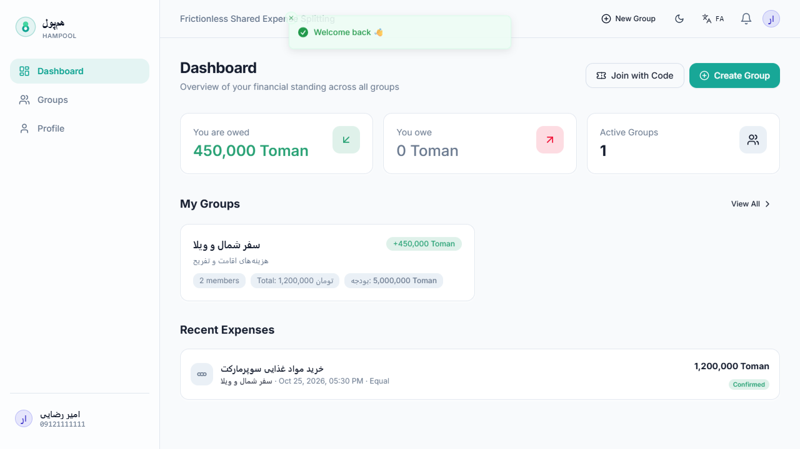
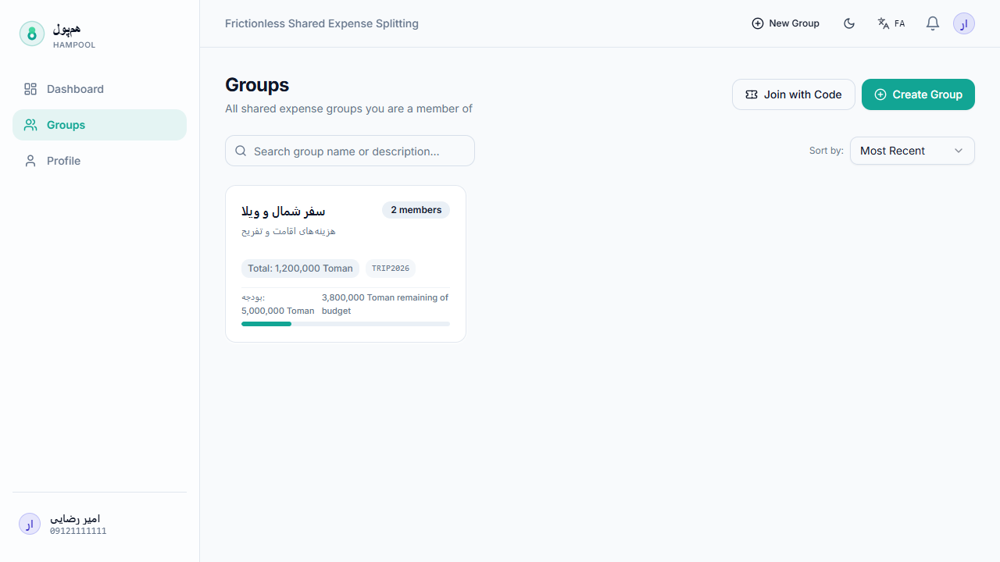
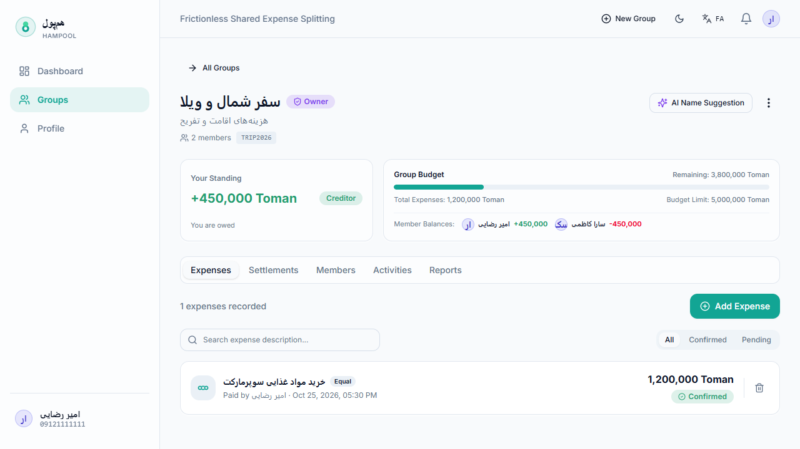
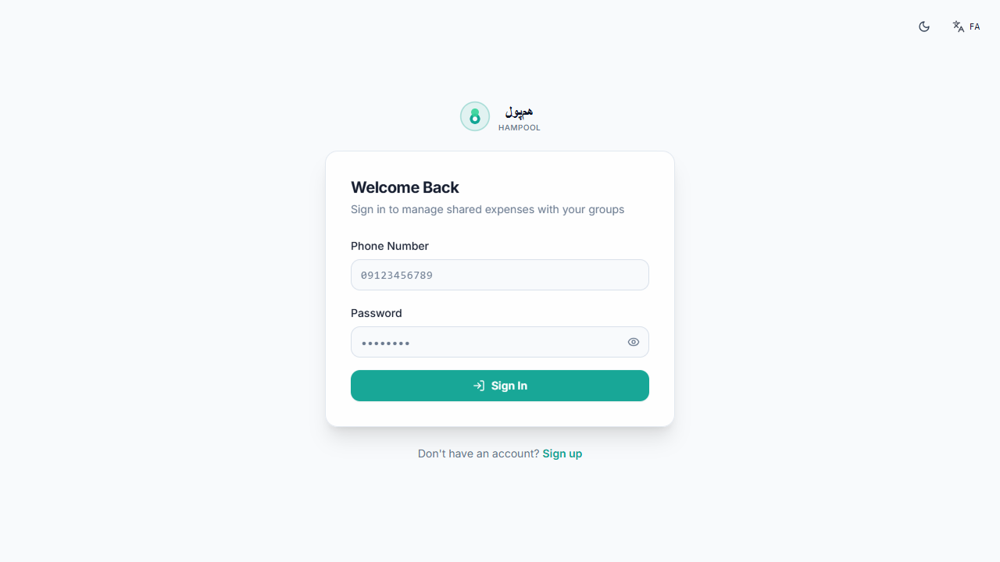

<div dir="rtl">

<p align="center">
  
</p>

<h1 align="center">💰 هم‌پول (HamPool) — پلتفرم جامع مدیریت هزینه‌های مشترک</h1>

<p align="center">
  <b>سامانه هوشمند ثبت دانگ و هزینه‌های گروهی بین دوستان، خانواده و هم‌سفرها</b><br />
  بک‌اند پرقدرت Django REST + فرانت‌اند مدرن React & Tailwind CSS با معماری PWA، تسویه‌ی بهینه، اعلان‌های لحظه‌ای WebSocket و دستیار نام‌گذاری هوش مصنوعی.
</p>

<p align="center">
  
  
  
  
  
  
  
  
  
  
  
  
  
</p>

---

## 🖼️ پیش‌نمایش محیط کاربری

<p align="center">
  
  <br />
  <sub><b>داشبورد مالی</b> — تراز کلی طلب/بدهی، خلاصه‌ی وضعیت گروه‌ها، آخرین هزینه‌ها و اقدامات سریع</sub>
</p>

<p align="center">
  
  <br />
  <sub><b>مدیریت گروه‌ها</b> — فیلتر آنی، پیشرفت بودجه، ساخت گروه جدید و عضویت با کد دعوت یا QR</sub>
</p>

<p align="center">
  
  <br />
  <sub><b>صفحه تفصیلی گروه</b> — تفکیک ۶ تب کاربردی: هزینه‌ها (۴ مدل تقسیم)، تسویه‌ها و بهینه‌سازی، اعضا و نقش‌ها، فعالیت‌ها و گزارش‌ها</sub>
</p>

<p align="center">
  
  <br />
  <sub><b>ورود و ثبت‌نام امن</b> — اعتبارسنجی دو مرحله‌ای با شماره موبایل و کد یک‌بار مصرف OTP</sub>
</p>

---

## 🌊 درباره هم‌پول

محاسبه و تقسیم هزینه‌ها در سفرهای دوستانه، زندگی هم‌خانگی یا دورهمی‌های کاری معمولاً پیچیده، زمان‌بر و مستعد خطاست. **هم‌پول** این دغدغه را به‌سادگی حل می‌کند:

1. **ثبت انعطاف‌پذیر هزینه‌ها:** هزینه‌ها می‌توانند به ۴ شیوه مختلف بین اعضا تسهیم شوند: **مساوی**، **مبلغ دقیق**، **درصدی** و **آیتمی** (بر اساس مصرف مجزای اقلام).
2. **محاسبه هوشمند بالانس:** به‌محض ثبت یا تغییر هر هزینه، تراز خالص (طلب/بدهی) تمامی اعضا بلافاصله به‌روزرسانی می‌شود.
3. **پیشنهاد تسویه بهینه (Debt Simplification):** سیستم با تحلیل شبکه بدهی‌ها، کمترین تعداد جابجایی وجه ممکن را برای صفر کردن کامل حساب‌ها پیشنهاد می‌کند (با محافظت همزمانی `balance_version`).
4. **همگام‌سازی بلادرنگ (WebSocket):** با بهره‌گیری از معماری Outbox و Django Channels، هر تغییری در کسری از ثانیه در صفحه سایر اعضای آنلاین منعکس می‌شود.
5. **دستیار هوش مصنوعی نام‌گذاری:** با استفاده از Google Gemini و تحلیل شرح هزینه‌ها و حال‌وهوای گروه، اسامی جذاب فارسی و انگلیسی برای گروه پیشنهاد داده می‌شود.
6. **فرانت‌اند مدرن با قابلیت PWA:** رابط کاربری واکنش‌گرا با پشتیبانی کامل از دارک‌مود/لایت‌مود، فونت‌های بهینه‌شده فارسی و انگلیسی، منوی کشویی جمع‌شونده و عملکرد آفلاین.

---

## ✨ ویژگی‌های شاخص سیستم

| بخش | ویژگی‌ها و قابلیت‌های پیاده‌سازی شده |
| :--- | :--- |
| 🔐 **احراز هویت و امنیت** | ثبت‌نام با شماره همراه معتبر ایران · تایید دومرحله‌ای با OTP (الگوریتم TOTP شش‌رقمی) · ورود با JWT (Access و Refresh) · بلک‌لیست توکن در خروج · کنترل سقف درخواست‌ها (Throttling) |
| 👥 **مدیریت پیشرفته گروه‌ها** | تعریف بودجه و پایش درصد مصرف · صدور کد دعوت اختصاصی ۸ کاراکتری زمان‌دار · بارکد دو بعدی (QR Code) اختصاصی جهت ورود سریع · سیستم کنترل دسترسی سطوح عضویت (مالک، مدیر، عضو عادی) · امکان انتقال مالکیت گروه |
| 💸 **تسهیم پیشرفته هزینه‌ها** | ۴ الگوریتم تقسیم: **مساوی**، **مبلغ دقیق**، **درصدی** و **آیتمی (تفکیک جزئی ریزفاکتور و شرکا)** · تایید دو مرحله‌ای هزینه‌ها · امکان حذف و فریز ویرایش برای هزینه‌های قطعی |
| 📊 **تسویه و بهینه‌سازی مالی** | تسویه حساب دوجانبه مستقیم · فرآیند تایید دریافت وجه توسط طلبکار · قابلیت ابطال تسویه · **پیشنهاد تسویه بهینه با حداقل تراکنش** برای رفع زنجیره بدهی چندنفره |
| 🔔 **رویدادهای زنده بلادرنگ** | WebSocket اختصاصی مبتنی بر Django Channels و Redis · الگوی قابلیت اطمینان **Outbox Pattern** جهت تضمین ارسال رویدادها حتی در صورت قطعی لحظه‌ای |
| 🤖 **دستیار نام‌گذاری هوش مصنوعی** | مجهز به پرامپت مهندسی‌شده و بومی در ماژول Gemini AI برای پیشنهاد نام‌های خلاقانه فارسی بر اساس دسته‌بندی و آیتم‌های مصرفی گروه (سفر، هم‌خانگی، کاری، کافه) |
| 📱 **تجربه کاربری و رابط فرانت‌اند** | بازنویسی کامل با React 18 + Vite + Tailwind CSS · پنل ناوبری کشویی (Collapsible Drawer) با بالانس آیکون‌ها و تول‌تیپ هوشمند · پشتیبانی دوزبانه زنده (فارسی RTL / انگلیسی LTR) · پشتیبانی از حالت تیره (Dark Mode) و روشن |
| 📶 **نصب‌پذیری و کارکرد PWA** | قابلیت نصب روی موبایل و دسکتاپ به عنوان Progressive Web App · Service Worker و استراتژی کش آفلاین · هشدار وضعیت اتصال اینترنت |
| 📄 **گزارش‌گیری PDF** | ایجاد خودکار صورت‌حساب‌های دوره‌ای و هفتگی PDF با WeasyPrint و رسم نمودارهای تحلیلی Matplotlib با قابلیت ارسال ایمیل |
| ⏱️ **پردازش پس‌زمینه و صف کارها** | اجرای تسک‌های سنگین با Celery Worker و مدیریت زمان‌بندی با Celery Beat · داشبورد نظارتی مانیتورینگ Flower |
| 🐳 **محیط کانتینری Docker** | استک کامل ۷ سرویسه هماهنگ توسعه و پروداکشن (PostgreSQL 16 + Redis 7 + Django + Celery Worker + Celery Beat + Flower + Nginx) |

---

## 🛠️ پشته فناوری (Tech Stack)

### بک‌اند (Backend)
- **زبان و فریم‌ورک:** Python 3.12+ · Django 5.2 · Django REST Framework (DRF)
- **دیتابیس:** PostgreSQL 16 (توسعه و پروداکشن) · SQLite3 (پشتیبانی تست مستقل)
- **صف وظایف و حافظه موقت:** Redis 7 · Celery 5.4 · Celery Beat
- **ارتباطات بلادرنگ:** Django Channels · Daphne / Uvicorn · Redis Channel Layer
- **تولید گزارشات:** WeasyPrint · Matplotlib
- **هوش مصنوعی:** Google Gemini API (`google.genai` / `google-generativeai`)
- **سرو و مستندسازی:** drf-yasg (OpenAPI / Swagger / ReDoc) · Nginx Reverse Proxy
- **تست‌ها:** pytest · pytest-django (۲۱۱ تست واحد و یکپارچه)

### فرانت‌اند (Frontend)
- **هسته و ابزار بیلد:** React 18 · TypeScript (Strict Mode) · Vite 5
- **طراحی و استایلینگ:** Tailwind CSS · Radix UI (shadcn/ui primitives) · Lucide Icons
- **مدیریت دیتا و کش:** TanStack Query (React Query v5) · Axios با مدیریت صف Refresh Token تک‌پروازی
- **مدیریت وضعیت:** Zustand (وضعیت اپلیکیشن و اعلان‌ها)
- **چندزبانه و فونت:** react-i18next (فارسی/انگلیسی) · قلم‌های رسمی Vazirmatn و Inter
- **اعتبارسنجی و فرم‌ها:** React Hook Form · Zod
- **نمودارها:** Recharts
- **قابلیت‌های PWA:** vite-plugin-pwa · Workbox (Service Worker)
- **تست و کیفیت:** Vitest · React Testing Library · MSW (Mock Service Worker) (۵۷ تست واحد) · ESLint

---

## 🏗️ معماری سیستم

<div dir="ltr">

```text
┌────────────────────────────────────────────────────────┐
│               Browser / PWA Client                     │
│      React 18 + Tailwind CSS + Lucide Icons            │
└──────────────────────────┬─────────────────────────────┘
                           │ HTTP / WebSocket (:80)
                           ▼
┌────────────────────────────────────────────────────────┐
│             Nginx Reverse Proxy & Static               │
│   /          → Serves SPA Dist (Vite Build)            │
│   /api/      → Proxy to Django Backend (:8000)         │
│   /ws/       → Upgrade to WebSocket (:8000)            │
│   /media/    → Static & Uploaded Media Files           │
└────────────┬─────────────────────────────┬─────────────┘
             │                             │
             ▼                             ▼
┌───────────────────────────┐  ┌─────────────────────────┐
│   Django REST & Channels  │  │   PostgreSQL 16 (db)    │
│   - apps/accounts (Auth)  │  └─────────────────────────┘
│   - apps/groups (Finance) │  ┌─────────────────────────┐
│   - apps/ai (Gemini)      │  │   Redis 7 (cache/layer) │
│   - apps/reports (PDF)    │  └────────────┬────────────┘
│   - apps/outbox (Events)  │               │
└────────────┬──────────────┘               ▼
             │ Transactional Outbox  ┌─────────────────────────┐
             └──────────────────────►│ Celery Worker & Beat    │
                                     │ Background Tasks & Jobs │
                                     └────────────┬────────────┘
                                                  ▼
                                     ┌─────────────────────────┐
                                     │ Flower Monitoring UI    │
                                     │ http://localhost:5555   │
                                     └─────────────────────────┘
```

</div>

---

## 🚀 راه‌اندازی سریع با داکر

> **پیش‌نیازها:** ابزار [Docker](https://www.docker.com/) و Docker Compose روی سیستم شما نصب و در حال اجرا باشند.

### ۱. دریافت پروژه و آماده‌سازی فایل تنظیمات

<div dir="ltr">

```bash
git clone https://github.com/MY-Jafari/HamPool.git hampool
cd hampool
cp .env.example .env
```

</div>

*(در صورت تمایل می‌توانید کلید `GEMINI_API_KEY` را در فایل `.env` جهت فعال‌سازی بخش هوش مصنوعی وارد کنید).*

### ۲. استارت کانتینرها

<div dir="ltr">

```bash
# بیلد و بالا آوردن تمامی ۷ کانتینر به صورت یکپارچه
docker compose up -d --build
```

</div>

### ۳. اجرای مایگریشن‌ها و آماده‌سازی اولیه دیتابیس

<div dir="ltr">

```bash
docker compose exec django python manage.py migrate
```

</div>

### ۴. تزریق داده‌های واقعی تستی (سیستم آزمایشی)

پروژه به یک دستور هوشمند جهت آماده‌سازی سناریوهای تستی فارسی مجهز است:

<div dir="ltr">

```bash
docker compose exec django python manage.py seed_demo_data
```

</div>

با اجرای این دستور، داده‌های تستی کامل شامل کاربر اصلی، دوستان، گروه‌های مختلف، هزینه‌های تاییدشده با مدل‌های تقسیم متنوع و تسویه‌های نمونه ساخته می‌شود.

---

## 👤 کاربر و اطلاعات تستی آماده (Demo Account)

جهت ورود آسان و بررسی کامل تمام قابلیت‌های نرم‌افزار، می‌توانید از اطلاعات حساب تستی زیر استفاده نمایید:

| فیلد | مقدار |
| :--- | :--- |
| **شماره موبایل** | `09121234567` |
| **رمز عبور** | `Password123!` |
| **نام کاربر** | یاسین جعفری |
| **گروه‌های فعال آماده** | 🏖️ سفر شمال، ☕ کافه و رستوران، 🏢 بچه‌های آپارتمان، 🍱 ناهار هفتگی شرکت |
| **داده‌های موجود** | هزینه‌های تفکیک‌شده، طلب و بدهی خالص، تاریخچه فعالیت‌ها و تسویه‌های منتظر تایید |

---

## 🌐 پورت‌ها و آدرس‌های دسترسی محلی

پس از اجرای کانتینرها، تمامی سرویس‌ها از طریق آدرس‌های زیر در دسترس خواهند بود:

| سرویس | آدرس محلی (URL) | مشخصات / راهنما |
| :--- | :--- | :--- |
| 💻 **فرانت‌اند وب و PWA** | [`http://localhost/`](http://localhost/) | رابط کاربری کامل برنامه (از طریق Nginx) |
| 🔌 **API سرور بک‌اند** | [`http://localhost:8000/api/v1/`](http://localhost:8000/api/v1/) | مستقیم یا از طریق `http://localhost/api/v1/` |
| 📖 **مستندات Swagger** | [`http://localhost:8000/swagger/`](http://localhost:8000/swagger/) | مستندات تعاملی اندپوینت‌های API |
| 📑 **مستندات ReDoc** | [`http://localhost:8000/redoc/`](http://localhost:8000/redoc/) | مشخصات ساختاریافته OpenAPI |
| 🌸 **داشبورد Celery Flower** | [`http://localhost:5555/`](http://localhost:5555/) | نام کاربری: `admin` · رمز عبور: `admin` |
| 🩺 **بررسی سلامت (Health)** | [`http://localhost/health/`](http://localhost/health/) | وضعیت کلی Nginx و سرویس‌ها |
| 🗄️ **دیتابیس PostgreSQL** | `localhost:5432` | نام کاربری: `hampool_user` · نام دیتابیس: `hampool` |

---

## 🧪 اجرای آزمون‌ها و اعتبارسنجی (Tests & CI)

تمامی تست‌های بک‌اند و فرانت‌اند به گونه‌ای پیکربندی شده‌اند که هم در محیط داکر و محلی و هم در سرورهای ابری GitHub Actions به صورت ۱۰۰٪ موفق و سبز اجرا شوند:

### ۱. اجرای تست‌های بک‌اند (Django + pytest)
پوشش کامل ۲۱۱ تست شامل تمامی اپلیکیشن‌ها (احراز هویت، گروه‌ها، محاسبات مالی، وب‌سوکت، هوش مصنوعی، Outbox و گزارش‌ها):

<div dir="ltr">

```bash
docker compose exec django pytest apps/ -v --tb=short
```

</div>

### ۲. اجرای تست‌های فرانت‌اند (Vitest + MSW)
اجرای ۵۷ تست واحد و تست‌های یکپارچه اعتبارسنجی فرم‌ها، فراخوانی API و عملکرد کامپوننت‌ها:

<div dir="ltr">

```bash
cd frontend
npm run test
```

</div>

### ۳. بررسی تایپ‌اسکریپت، لینتر و بیلد نهایی
اعتبارسنجی کامل کدهای فرانت‌اند بدون کوچک‌ترین ارور یا خطا:

<div dir="ltr">

```bash
cd frontend
npx tsc -b
npm run lint
npm run build
```

</div>

---

## 🔄 خط لوله پیوسته GitHub Actions CI/CD

فایل گردش کار [`.github/workflows/ci.yml`](.github/workflows/ci.yml) در هر Push یا Pull Request روی شاخه `main` مراحل زیر را ارزیابی می‌کند:

1. **جایگاه تست بک‌اند (`backend-test`):**
   - راه‌اندازی رانر اوبونتو به همراه پایتون ۳.۱۲ و کانتینر سرویس Redis
   - نصب پکیج‌های سیستم‌عامل مورد نیاز WeasyPrint (مانند Pango و Cairo)
   - ساخت محیط ایزوله تست و اجرای `pytest apps/ -v --tb=short`
2. **جایگاه بررسی فرانت‌اند (`frontend-test`):**
   - راه‌اندازی Node.js نسخه ۲۰ به همراه سیستم کش npm
   - اجرای تایپ‌چک کامل کدهای پروژه با `npx tsc -b`
   - بررسی قوانین استایل و کیفیت با `npm run lint`
   - اجرای تست‌های کامپوننت‌ها و استور با `npm run test`
   - اعتبارسنجی بیلد بهینه‌شده تولیدی با `npm run build`
3. **اعتبارسنجی داکر (`build`):**
   - بیلد ایمیج نهایی کانتینر داکر جهت اطمینان از صحت استقرار در محیط‌های ابری

---

## 🗂️ ساختار فایل‌ها و شاخه‌ها

<div dir="ltr">

```text
hampool/
├── .github/
│   └── workflows/
│       └── ci.yml               # خط لوله تست پیوسته GitHub Actions
├── apps/                        # ماژول‌های اصلی بک‌اند جنگو
│   ├── accounts/                #   احراز هویت، کاربر سفارشی، OTP و توکن‌های JWT
│   ├── groups/                  #   گروه، اعضا، هزینه‌ها، تسویه‌ها، بالانس و لاگ
│   │   ├── api/v1/              #     کنترلرها، ویوها و سریالایزرهای DRF
│   │   ├── services.py          #     الگوریتم‌های مالی و بهینه‌سازی تسویه
│   │   ├── consumers.py         #     اتصال و مدیریت کانال‌های WebSocket
│   │   └── management/commands/ #     دستور seed_demo_data جهت تزریق داده نمونه
│   ├── ai/                      #   سرویس‌های هوش مصنوعی پیشنهاد نام گروه با Gemini
│   ├── reports/                 #   تولید و ارسال گزارش‌های هفتگی PDF
│   └── outbox/                  #   پیاده‌سازی الگوی Transactional Outbox
├── core/                        # پیکربندی مرکزی پروژه، تنظیمات، ASGI و Celery
├── frontend/                    # اپلیکیشن فرانت‌اند مدرن (React + TypeScript + PWA)
│   ├── public/                  #   فاوآیکون‌ها، آیکون‌های استاندارد PWA و منیفست
│   ├── src/
│   │   ├── app/                 #   مسیریابی، Layout اصلی، منوی کشویی و Providerها
│   │   ├── features/            #   ماژول‌های auth، groups، dashboard و notifications
│   │   └── shared/              #   کامپوننت‌های پایه UI، سرویس‌های API، هوک‌ها و انواع
├── nginx/                       # تنظیمات سرور Nginx و ریورس‌پروکسی
├── screenshots/                 # تصاویر مستندات و وکتور لوگوی رسمی پروژه
├── docker-compose.yml           # کانتینرهای محیط توسعه
├── docker-compose.prod.yml      # کانتینرهای محیط پروداکشن
├── Dockerfile                   # ایمج اختصاصی پایتون بک‌اند
├── pytest.ini                   # تنظیمات تست‌های pytest
└── requirements.txt             # نیازمندی‌های پایتون
```

</div>

---

## 🤝 مشارکت و توسعه (Contributing)

از هرگونه مشارکت، گزارش باگ یا پیشنهاد ویژگی جدید استقبال می‌شود:

1. ابتدا مخزن را Fork کنید.
2. یک شاخه برای قابلیت جدید بسازید:
   `git checkout -b feature/amazing-feature`
3. تغییرات خود را اعمال کنید و مطمئن شوید تست‌های بک‌اند و فرانت‌اند پاس می‌شوند:
   `docker compose exec django pytest apps/`
   `cd frontend && npm run test && npm run build`
4. تغییرات را Commit کنید:
   `git commit -m "feat: add amazing new feature"`
5. تغییرات را به شاخه خود Push کرده و یک Pull Request ارسال نمایید.

---

## 👨‍💻 توسعه‌دهنده

<p align="center">
  <a href="https://github.com/MY-Jafari">
    
  </a>
  &nbsp;
  <a href="https://www.linkedin.com/in/mohammadyasin-jafari-422706378">
    
  </a>
</p>

---

## 📄 مجوز (License)

این پروژه تحت مجوز **MIT** منتشر شده است. برای اطلاعات بیشتر فایل [LICENSE](LICENSE) را مطالعه فرمایید.

</div>
